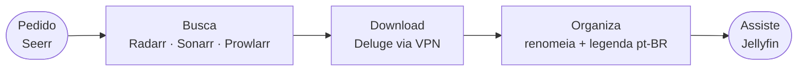

<p align="center">
  <picture>
    <source media="(prefers-color-scheme: dark)" srcset="assets/logo/locadora-horizontal-dark.svg">
    
  </picture>
</p>

<p align="center">
  <strong>Seu serviço de streaming, no seu servidor.</strong><br>
  Peça um filme ou série; ele é encontrado, baixado pela VPN, organizado e aparece pronto para
  assistir, de preferência dublado em português.
</p>

<p align="center">
  
  
  
  
</p>

---

## Como funciona



1. **Você pede** no Seerr, um catálogo parecido com o dos serviços de streaming.
2. **Radarr** (filmes) ou **Sonarr** (séries) procura nos indexadores pelo **Prowlarr** e escolhe a
   melhor versão: dublada em português; se não houver, no idioma original.
3. **Deluge** baixa através do **Gluetun** (WireGuard). Sem VPN, sem internet: nada vaza.
4. O arquivo é renomeado e movido para a biblioteca; o **Bazarr** busca e sincroniza a legenda pt-BR.
5. O filme aparece no **Jellyfin**, no navegador, no celular ou na TV.

Séries são acompanhadas: episódios novos chegam sozinhos.

## Destaques

- **Instalação em um comando.** O `setup.sh` sobe tudo e configura cada serviço pela API:
  contas, conexões entre serviços, perfis e bibliotecas. Pode rodar de novo a
  qualquer momento.
- **Português primeiro.** Prioriza versões dubladas, recusa dublagens em outros idiomas e
  troca sozinho para a dublada quando ela aparece. [Detalhes](docs/idioma-e-legendas.md)
- **Cada pessoa do seu jeito.** O Painel (ou `./pessoas.sh`) cadastra a família; cada um escolhe dublado ou original
  e a legenda (pt-BR, inglês ou nenhuma), e os pedidos dela seguem essa escolha.
- **Catálogo do Brasil.** "Em alta" e "onde assistir" (Netflix BR, Globoplay…) com dados do Brasil.
- **Legendas que batem.** pt-BR só quando o áudio não é português, sincronizadas com o áudio do arquivo.
- **Privado por padrão.** Downloads só pela VPN, com kill switch e redirecionamento de porta.
- **Traga os filmes que você já tem.** `./importar.sh ~/Videos/Filmes` reconhece cada filme pelo nome
  (em português ou no original) e põe na biblioteca, sem mexer nos originais nem ocupar espaço a mais.
- **Pedidos pelo Telegram.** Cada pessoa pede conversando com o bot e é avisada quando fica pronto.
- **De fora de casa, sem abrir porta.** Com o Tailscale, Jellyfin e Seerr em `https://locadora.<sua-rede>.ts.net`.
- **Limpeza automática.** Filmes que todo mundo já viu há 30 dias saem sozinhos (favoritos ficam).
  [Telegram, Tailscale e limpeza](docs/extras.md)
- **Atualização com backup.** `./atualizar.sh` guarda as configurações, atualiza e confere tudo;
  `--restaurar` volta atrás.
- **Diagnóstico em um comando.** `./diagnostico.sh` confere VPN, disco e serviços e diz em português o que fazer.
- **Um login para tudo.** O mesmo usuário e senha em todos os serviços; `./change-password.sh` troca em todos.
- **Sem espaço duplicado.** Hardlinks entre a pasta de downloads e a biblioteca.
- **Aceleração por GPU** no Jellyfin quando disponível (Intel/AMD).

## Instalação

Baixe o pacote do seu sistema em **[Releases](https://github.com/Langendolff/Locadora/releases/latest)**:

| Sistema | Pacote | Requisitos |
|---|---|---|
| **Windows 10/11** | `Locadora-…-windows.zip` → **Instalar.bat** | WSL2 + Docker Desktop |
| **macOS** | `Locadora-…-macos.zip` → **Instalar.command** | Docker Desktop |
| **Linux** | `Locadora-…-linux.tar.gz` → `./setup.sh` | Docker + compose |

Você também precisa do arquivo **WireGuard (.conf)** de uma VPN que permita P2P (recomendado:
ProtonVPN pago, servidor P2P com NAT-PMP; [como gerar](docs/configuracao.md#protonvpn-recomendado-plano-pago)).
Passo a passo de cada sistema: [docs/instalacao.md](docs/instalacao.md).

No Linux, também dá pra instalar direto do repositório:

```bash
git clone https://github.com/Langendolff/Locadora.git
cd Locadora
./setup.sh ~/Downloads/sua-vpn.conf
```

O instalador pergunta um usuário e uma senha, sobe os serviços, confere se o tráfego está saindo
pela VPN e configura tudo. Opcional: uma conta grátis no [OpenSubtitles](https://www.opensubtitles.com)
no `.env` para melhorar as legendas.

**Depois de instalar, escolha os indexadores** (os sites onde a busca acontece): a Locadora não
vem com nenhum. No Prowlarr (http://localhost:9696) → Indexers → Add Indexer.
[Como escolher](docs/indexadores.md).

## Serviços

| Serviço | Endereço | Para quê |
|---|---|---|
| **Seerr** | http://localhost:5055 | Pedir filmes e séries |
| **Jellyfin** | http://localhost:8096 | Assistir |
| Radarr | http://localhost:7878 | Filmes |
| Sonarr | http://localhost:8989 | Séries |
| Prowlarr | http://localhost:9696 | Indexadores |
| Bazarr | http://localhost:6767 | Legendas |
| Deluge | http://localhost:8112 | Downloads |
| **Painel** | http://localhost:8585 | Pessoas, diagnóstico, configurações, atualizar e backups, pelo navegador |

No dia a dia, você só usa os dois primeiros (e o Painel para cadastrar alguém). Em outros aparelhos da rede, troque `localhost` pelo
IP do servidor.

## Comandos

Todos rodam no terminal, dentro da pasta da Locadora. No Windows, abra o **Ubuntu** (WSL) e
entre na pasta com `cd ~/Locadora`.

### Instalar e manter

| Comando | O que faz |
|---|---|
| `./setup.sh [vpn.conf]` | Instala ou reaplica tudo: cria o `.env`, sobe os serviços, confere a VPN e configura cada serviço. Pode rodar de novo sempre que mudar o `.env`: o que já está certo é mantido. Na primeira vez, passe o arquivo WireGuard da VPN |
| `./atualizar.sh` | Atualiza com segurança: backup das configurações, imagens novas, reaplica e roda o diagnóstico |
| `./atualizar.sh --backup` | Só o backup (fica em `backups/`, os 5 mais recentes; filmes não entram) |
| `./atualizar.sh --restaurar [arquivo]` | Volta as configurações de um backup. Sem arquivo, lista os disponíveis |
| `./diagnostico.sh` | Confere VPN (inclusive se está vazando), disco, serviços, indexadores, fila e logins, e diz o que fazer. Não muda nada |
| `./change-password.sh` | Troca a senha do admin em todos os serviços de uma vez |

### Pessoas e filmes

O **Painel** (http://localhost:8585, mesmo login dos serviços) faz pelo navegador o mesmo que
`pessoas.sh`, `diagnostico.sh`, `atualizar.sh` (atualizar, backup, restaurar) e `change-password.sh`,
e edita os campos do `.env` que você preenche.

| Comando | O que faz |
|---|---|
| `./pessoas.sh` | Lista as pessoas da casa e a preferência de cada uma |
| `./pessoas.sh nova NOME [áudio] [legenda]` | Cadastra alguém no Jellyfin e no Seerr (pede a senha). Áudio: `dublado` ou `original`; legenda: `pt-br`, `en` ou `nenhuma` |
| `./pessoas.sh preferencia NOME [áudio] [legenda]` | Muda a preferência de alguém. Vale para os pedidos, a reprodução e as legendas baixadas |
| `./importar.sh PASTA [--simular]` | Traz filmes que você já tem (ex.: `~/Videos/Movies`). Reconhece pelo nome `Título (Ano)`, em português ou no original. Não mexe nos originais e, no mesmo disco, não ocupa espaço extra. `--simular` só mostra o que reconheceu |
| `./limpeza.sh` | Mostra o que a limpeza automática tiraria hoje e o que sai em breve. Não apaga nada |
| `./limpeza.sh agora` | Roda a limpeza agora (normalmente roda sozinha, às 4h, se `LIMPEZA_DIAS` estiver no `.env`) |

### Atalhos de clique duplo

| Sistema | Arquivo | O que faz |
|---|---|---|
| Windows | `Instalar.bat` | Instala ou atualiza (roda o `setup.sh` dentro do WSL) |
| Windows | `Diagnostico.bat` | Roda o `./diagnostico.sh` |
| macOS | `Instalar.command` | Instala ou atualiza |
| macOS | `Diagnostico.command` | Roda o `./diagnostico.sh` |

### No Telegram (@ do seu bot)

| Mensagem | O que faz |
|---|---|
| `/entrar usuário senha` | Liga o Telegram à sua conta (o login do Jellyfin). A mensagem é apagada na hora |
| nome de um filme ou série | Procura e mostra botões para pedir |
| `/pedidos` | Seus pedidos e como estão |
| `/sair` | Desliga o Telegram da sua conta |

### Docker (para quem quer mexer por baixo)

```bash
docker compose ps                  # status de cada serviço
docker compose logs -f SERVIÇO     # logs (ex.: gluetun, radarr, tarefas)
docker compose restart SERVIÇO     # reinicia um serviço
docker compose down                # para tudo (filmes e configurações ficam)
```

## Documentação

| | |
|---|---|
| [Instalação](docs/instalacao.md) | Windows, macOS e Linux |
| [Arquitetura](docs/arquitetura.md) | Fluxo, rede/VPN, pastas e hardlinks |
| [Configuração](docs/configuracao.md) | Variáveis do `.env`, VPN, portas, GPU, disco |
| [Idioma e legendas](docs/idioma-e-legendas.md) | Regras de escolha do áudio, Bazarr, Jellyfin |
| [Importar, Telegram, Tailscale e limpeza](docs/extras.md) | Seus filmes, bot de pedidos, acesso de fora de casa, limpeza |
| [Indexadores](docs/indexadores.md) | Como escolher e adicionar os seus |
| [Solução de problemas](docs/solucao-de-problemas.md) | Download parado, erro no player, VPN… |
| [Desenvolvimento](docs/desenvolvimento.md) | Estrutura do repositório e como estender |

## Licença

[MIT](LICENSE) © Lorenzo Langendolff Cardoso

## Aviso

Este projeto organiza ferramentas de código aberto. A VPN protege sua privacidade, mas não torna
legal o download de conteúdo protegido por direitos autorais. O que baixar é responsabilidade de
quem usa.
