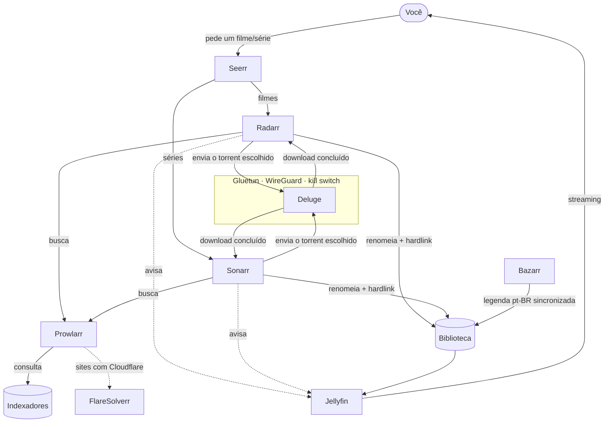

# Arquitetura

## Fluxo de um pedido



## Componentes

| Serviço | Papel | Imagem |
|---|---|---|
| **Seerr** | Vitrine de pedidos (catálogo, pedidos, status) | `ghcr.io/seerr-team/seerr` |
| **Radarr** | Gerencia filmes: busca, escolhe, importa, renomeia | `lscr.io/linuxserver/radarr` |
| **Sonarr** | O mesmo para séries, incluindo episódios novos | `lscr.io/linuxserver/sonarr` |
| **Prowlarr** | Centraliza os indexadores e os sincroniza com Radarr/Sonarr | `lscr.io/linuxserver/prowlarr` |
| **FlareSolverr** | Resolve o desafio do Cloudflare de alguns indexadores | `ghcr.io/flaresolverr/flaresolverr` |
| **Gluetun** | Túnel WireGuard com kill switch e redirecionamento de porta | `qmcgaw/gluetun` |
| **Deluge** | Cliente BitTorrent; usa a rede do Gluetun | `lscr.io/linuxserver/deluge` |
| **Bazarr** | Baixa e sincroniza legendas pt-BR | `lscr.io/linuxserver/bazarr` |
| **Jellyfin** | Servidor de mídia (web, celular, TV) | `lscr.io/linuxserver/jellyfin` |

## Rede e VPN

- O Deluge roda com `network_mode: service:gluetun`: **não tem interface de rede própria**.
  Todo o tráfego dele sai pelo túnel; se a VPN cair, ele fica sem internet (kill switch do Gluetun).
- `FIREWALL_OUTBOUND_SUBNETS` libera só as redes locais (`172.16.0.0/12`, `192.168.0.0/16`) para
  que Radarr/Sonarr conversem com o Deluge. **Não inclua `10.0.0.0/8`**: é a faixa interna da
  Proton, e incluí-la desvia o tráfego do túnel (quebra o redirecionamento de porta).
- **Redirecionamento de porta (Proton pago):** o Gluetun obtém uma porta via NAT-PMP e grava em
  `config/gluetun/forwarded_port`. O serviço `scripts/deluge-portforward.sh`, que roda dentro do
  container do Deluge, aplica essa porta e acompanha mudanças.
- Os demais serviços usam a rede bridge padrão do compose e se acham pelo nome
  (`http://radarr:7878`, `http://gluetun:8112` para o Deluge, etc.).

## Pastas e hardlinks

```
${DATA_ROOT}/
├── torrents/            ← Deluge (montado só aqui)
│   ├── incomplete/
│   ├── movies/
│   └── tv/
└── media/               ← biblioteca (Jellyfin lê em modo somente leitura)
    ├── movies/
    └── tv/
```

Radarr e Sonarr enxergam o `${DATA_ROOT}` inteiro em `/data`. Ao importar, criam um **hardlink**
de `torrents/` para `media/`: o mesmo arquivo aparece nos dois lugares sem ocupar espaço duas vezes,
e o Deluge continua compartilhando enquanto o Jellyfin exibe a versão organizada.
Por isso `torrents/` e `media/` **precisam estar no mesmo sistema de arquivos**.

## Configuração automática

`./setup.sh` prepara o `.env`, sobe os containers, confere a VPN e roda o container efêmero
`setup` (perfil `setup` do compose), que executa `scripts/configure.py`. Esse script configura cada
serviço pela API dele, módulo por módulo (`scripts/stack/`). Ele é **idempotente**: o que já está
configurado é mantido, então pode ser executado quantas vezes for preciso.
